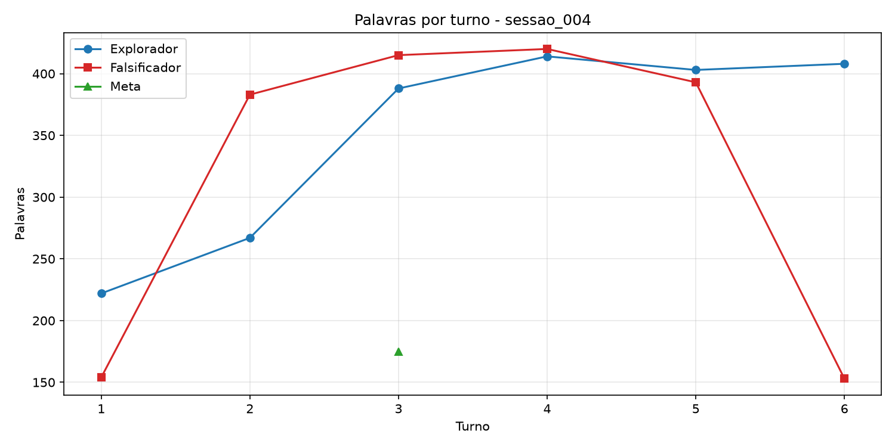
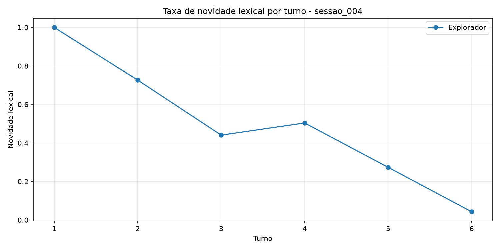
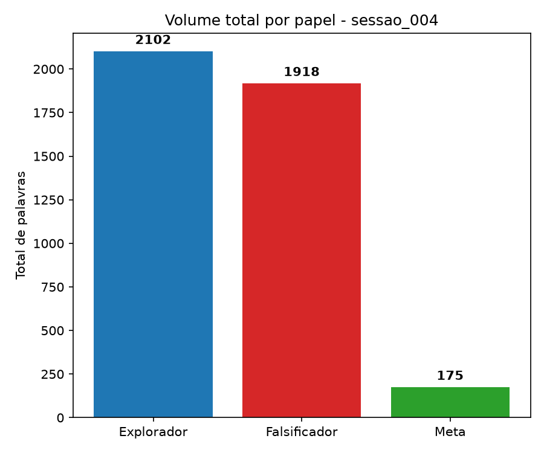

# LLM Dialogue Lab

Um sistema de descoberta autonoma com dois modelos de linguagem pequenos (3B) rodando 100% localmente, projetado para testar se e possivel gerar algo que nao estava contido no prompt inicial.

## A Pergunta

Dois modelos de 3B, com papeis de **Explorador** (propoe hipoteses) e **Falsificador** (constroi contraexemplos), sao capazes de gerar uma sintese que represente transformacao real em relacao a proposta inicial -- sem intervencao humana durante o processo?

## A Hipotese

Um dialogo adversarial estruturado entre arquiteturas distintas (Qwen 2.5 3B / Alibaba + Hermes 3 3B / NousResearch) produz divergencia semantica mensuravel entre a proposta inicial e a final, com taxa de novidade lexical que se mantem acima de zero ao longo dos turnos.

## Stack e Adaptacao Metodologica

O experimento original previa Qwen 7B e Mistral 7B. Devido a restricoes de hardware (dois modelos 7B nao cabem simultaneamente em memoria), a dupla foi reduzida para modelos 3B, mantendo a premissa de arquiteturas e empresas distintas. Ambos rodam 100% em GPU, mantidos em memoria com keep_alive=-1.

| Papel | Modelo | Empresa |
|-------|--------|---------|
| Explorador | qwen2.5:3b | Alibaba |
| Falsificador | hermes3:3b | NousResearch |
| Embeddings | nomic-embed-text | Nomic AI |

## Metodologia

- 6 turnos de Explorador + Falsificador
- 1 pausa de meta-reflexao no turno 3 (o sistema analisa o proprio historico)
- Seed fixa (42) para reprodutibilidade
- Metricas objetivas: novidade lexical por turno + divergencia semantica via embeddings
- Codigo do orquestrador privado; prompts e resultados publicados

## Resultados (Sessao 004)

### Metricas objetivas

| Metrica | Valor | Interpretacao |
|---------|-------|---------------|
| Divergencia semantica (turno 1 vs 6) | **0,1915** | Transformacao moderada |
| Total de palavras - Explorador | 2.102 | Engajamento consistente |
| Total de palavras - Falsificador | 1.918 | Critica substancial |

### Graficos

### Achados

1. **A divergencia de 0,19 indica transformacao parcial**: a proposta final nao e identica a inicial, mas o sistema nao produziu uma ruptura radical. O espaco de busca foi explorado, nao esgotado.
2. **O Falsificador saturou no turno 6**: caiu de 393 para 153 palavras. Isso sugere que o Explorador convergiu para uma proposta dificil de falsificar, OU que o Falsificador esgotou contraexemplos genuinamente distintos.
3. **A curva em U invertido** (crescimento -> pico -> plato -> colapso) corresponde ao padrao de saturacao de busca descrito na literatura de descoberta autonoma.

### Limitacoes

- Uma unica sessao nao permite inferencia estatistica. Os numeros sao indicativos, nao conclusivos.
- Modelos 3B tem capacidade limitada de julgar novidade real; a divergencia semantica mede mudanca, nao valor.
- O criterio de parada foi fixo (6 turnos). Um sistema adaptativo poderia encerrar antes no turno 6 ou continuar.

## Estrutura do Repositorio

| Pasta | Conteudo |
|-------|----------|
| conversations/ | Sessoes completas em JSON |
| results/ | Metodologia sintetizada e resumo executivo |
| analysis/charts/ | Graficos gerados a partir dos JSONs |
| analysis/scripts/ | Scripts de analise (publicos, reprodutiveis) |
| replication/ | Instrucoes para reproduzir o experimento |

## Como Replicar

Veja replication/SETUP.md. Os prompts completos estao em replication/PROMPTS.md. O codigo do orquestrador e privado por opcao do autor, mas a logica esta descrita em replication/SCRIPTS_EXAMPLE.md e qualquer pessoa com Python basico e a biblioteca ollama reproduz em menos de 30 minutos.

## Licenca

MIT. Veja [LICENSE](LICENSE) para os termos completos.
